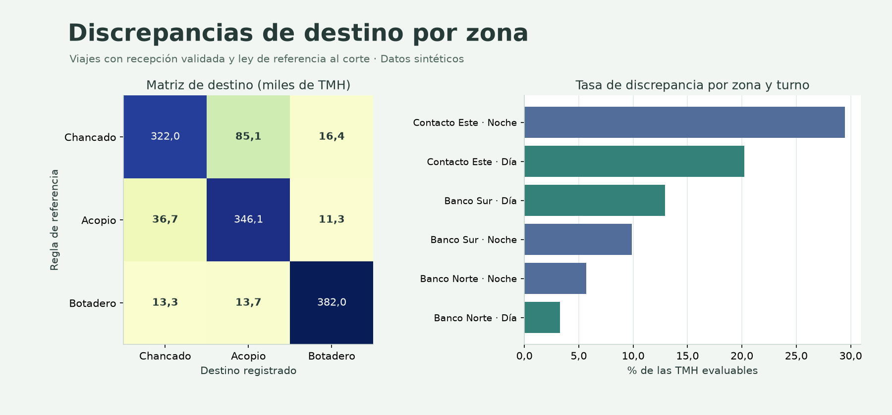

# Dispatch y control de mineral · Mina Cerro Lucero

Caso de portafolio para una mina de cobre ficticia. Cruza el registro de despacho con la recepción en chancado, acopio o botadero y con las versiones aprobadas de ley por bloque. El objetivo es priorizar viajes que merecen investigación y mostrar qué parte de la discrepancia era visible con la información disponible al despachar.

## Hallazgos del caso sintético

- **5.691 viajes cargados** en siete días y **5.426 recepciones validadas** (95,3 %). El QA/QC consolidó 169 viajes con reenvíos idénticos y dejó 265 viajes pendientes de revisión al corte.
- Hubo **360 cambios de destino frente al plan** y **780 discrepancias frente a la regla de ley posterior**. Los indicadores tienen referencias distintas y pueden solaparse. De las discrepancias geológicas, **443 aparecieron con una actualización de ley**.
- **Contacto Este, turno noche** registró la mayor proporción de tonelaje con discrepancia (**29,5 %** de 235.537 TMH evaluables). En toda la operación, **16.378 TMH** de material clasificado para chancado por la referencia posterior se registraron en botadero.
- En chancado, la hora de llegada **20:00** tuvo el mayor P90 de espera (**21,3 min**, 67 recepciones validadas). Conviene contrastar ese tramo horario con el volumen de llegadas y la bitácora de planta antes de atribuir una causa.

Las leyes provienen de un modelo sintético por bloque. Los indicadores identifican señales de investigación. Para inferir impacto sobre cobre recuperable se requieren balances en base seca, validación del destino, recuperación y criterios operativos.



Consulta el [informe para operaciones](resultados/informe.md), las [recepciones validadas por turno](resultados/figuras/01_recepcion.png) y la [espera en chancado](resultados/figuras/03_espera_chancado.png).

## Reproducir en Python y SQL

Necesitas Python 3.10 o posterior, SQLite 3.30 o posterior integrado en Python y Matplotlib.

```bash
python -m pip install -r requirements.txt
python src/analizar.py
```

La corrida usa los CSV de `datos/` y escribe en `resultados/`. Para generar de nuevo los CSV sintéticos con la misma semilla, ejecuta `python src/simular.py`. El caso reproduce una semana de 32 camiones activos, tres zonas y 18 unidades de material identificadas como bloques. Las demoras, la tasa de cambio de destino y los controles de calidad son supuestos de la simulación.

## Adaptarlo a tu operación

1. Crea una carpeta con tres CSV UTF-8, encabezados exactos, separador de coma y punto decimal. Usa timestamps locales de la operación como `2025-09-08 07:25:00`, con todos los relojes en la misma zona horaria. Este ejemplo usa hora de Lima y atribuye los viajes al día operativo de **07:00 a 06:59**, con guardia de día de 07:00 a 18:59.
2. Usa los archivos de ejemplo como plantilla y conserva una fila por entidad.

   | Archivo | Qué registrar |
   | --- | --- |
   | [viajes.csv](datos/viajes.csv) | `viaje_id` único, `salida` del punto de carguío, `camion`, `pala`, `zona`, `bloque`, `destino_plan` y `carga_tmh`. |
   | [recepciones.csv](datos/recepciones.csv) | `evento_id` único, `viaje_id`, `destino` registrado, `llegada`, `inicio_descarga`, `fin_descarga`, `registrado_en` y `peso_tmh`. Conserva reenvíos como eventos separados para auditar el sistema. |
   | [leyes.csv](datos/leyes.csv) | `bloque`, `disponible_en` de la versión, `cu_pct` y `aprobado` (0 o 1). Usa `0.30` para **0,30 % Cu** e incluye el momento efectivo de disponibilidad de la versión. |

3. Mapea los destinos físicos a `CHANCADO`, `ACOPIO` o `BOTADERO`. Define una tolerancia de diferencias de peso y acuerda las bandas operativas con el equipo de mina. La regla del ejemplo usa 0,30 % Cu o más para chancado, 0,18 % Cu o más para acopio cuando el material está por debajo del corte de chancado y botadero para el resto.
4. Ejecuta con un corte explícito y una carpeta de resultados nueva.

   ```bash
   python src/analizar.py --datos datos/mi_campana --salida resultados/mi_campana --corte "2025-09-22 18:00:00" --ley-chancado 0.30 --ley-acopio 0.18 --tolerancia-peso 5
   ```

5. Revisa primero el [informe](resultados/informe.md) y después la [lista de viajes por investigar](resultados/revision_destinos.csv). Usa `viaje_id` para llegar al registro de despacho, comprobar la recepción y recuperar la versión de ley que estaba disponible en ese momento.

## Cómo se calcula

- [Esquema SQL](sql/esquema.sql) y [consultas SQL](sql/analisis.sql). SQLite captura los eventos disponibles a la fecha de corte. Consolida reenvíos con idéntico destino, tiempos y peso. Dos o más firmas diferentes para un viaje requieren revisión. También se señalan viajes sin recepción al corte, secuencias inválidas, discrepancias de peso y eventos huérfanos.
- **Ley al despacho.** Última versión aprobada disponible cuando salió el camión. **Ley de referencia.** Última versión aprobada disponible al preparar el informe. El cambio de destino frente al plan se mide aparte del contraste con la regla de ley. Un viaje con recepción validada puede quedar sin evaluación de ruta si falta una referencia aprobada.
- **Denominador por zona y turno.** Toneladas recibidas de viajes validados con ley de referencia. La tasa divide las TMH con discrepancia entre ese total. Las rutas a acopio pueden reflejar decisiones legítimas de mezcla, contingencias o inventario.
- **P90 de espera.** Percentil empírico de minutos entre llegada al destino e inicio de descarga. Se presenta para las horas con al menos diez recepciones validadas en chancado. Sirve para investigar la cola de recepción y no representa la duración completa del ciclo.

## Resultados para auditar

| Archivo | Para qué sirve |
| --- | --- |
| [viajes_auditados.csv](resultados/viajes_auditados.csv) | Un registro por viaje, con QA/QC, destino y versiones de ley. |
| [kpi_turno.csv](resultados/kpi_turno.csv) | Viajes y tonelaje cargado o validado por día y turno. |
| [rutas_zona.csv](resultados/rutas_zona.csv) | Tonelaje evaluable y tasas de discrepancia por zona y turno. |
| [revision_destinos.csv](resultados/revision_destinos.csv) | Viajes validados con discrepancia. Los de mineral a botadero aparecen primero. |
| [qa_orfanas.csv](resultados/qa_orfanas.csv) | Eventos que carecen de un viaje asociado. |
| [resumen.json](resultados/resumen.json) | Indicadores agregados, criterios de la corrida y P90 de espera por hora. |
